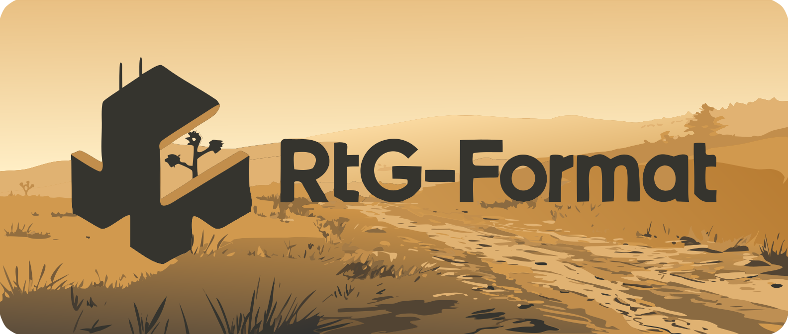

# RtG-Format

<div class="banner-container">
  
</div>

**Independent reverse-engineering documentation and tooling for the save/build format used by Road To Gramby's on Roblox.**

[](https://github.com/JuanCrakYT/RtG-Format)
[](SPECIFICATION.md)

> **Official trailer:** *Coming soon.*  
> **Permanent YouTube link:** `<!-- Add the published YouTube URL here -->`

The project investigates how RtG builds are represented, connected, serialized, and encoded. It also provides supporting research, examples, 3D assets, and tools for working with the observed data.

> **Project status:** Reverse-engineering and documentation are ongoing. Not every field or behavior is fully understood. Consult the confidence/evidence notes in the relevant documents before relying on an interpretation.

## Start here

| If you want to… | Start with |
| --- | --- |
| Understand the currently documented format | [Specification](SPECIFICATION.md) |
| Learn how the repository is organized | [Repository map](docs/repository-structure.md) |
| Follow a beginner-friendly reading path | [Documentation index](docs/README.md) |
| Browse every maintained Markdown document | [Markdown inventory](docs/documentation-inventory.md) |
| Explore field-level format details | [Format reference](format/README.md) |
| Find object/part identifiers | [Parts ID reference](blocks/parts/parts-id.md) |
| Understand save encoding and compression | [Compression documentation](compression/README.md) |
| Review experiments and open questions | [Research index](research/README.md) |
| Inspect sample builds and experiments | [Examples](examples/README.md) |
| Visualize a build in a browser | [RtG-Preview](RtG-Preview/README.md) |
| Work with the command-line tooling | [RtG-CLI](RtG-CLI/README.md) |
| Explore the RtG language implementation | [RtG Language](RtG%20Language/README.md) |

## What this repository contains

- **Format specification** — the current consolidated interpretation of the observed save/build representation.
- **Format reference** — detailed notes about structure, identifiers, connections, properties, and fields that remain uncertain.
- **Research** — methodology, reproducible observations, discoveries, and unresolved questions.
- **Examples and assets** — sample data, experiments, and model assets used by the project.
- **Tools** — supporting scripts and applications, including RtG-CLI, RtG-Preview, and RtG Language.
- **Documentation website** — source files under `page/`, deployed through the repository's configured GitHub Pages workflow.

## Conceptual save pipeline

The exact implementation details are still under investigation. At a high level, the project documents these layers separately:

```text
RtG build
   │
   ▼
Structured build/save data
   │
   ▼
JSON-like representation
   │
   ▼
Encoding and/or compression
   │
   ▼
Final save representation
```

This is a documentation model, not a claim that every internal game step has been proven. See [the specification](SPECIFICATION.md) and [compression notes](compression/README.md) for the current evidence and limitations.

## Research and evidence standards

RtG-Format is a reverse-engineering project, so documentation must distinguish observation from interpretation.

- Do not invent field meanings, IDs, or behavior.
- Prefer reproducible experiments and comparisons between samples.
- Label uncertain claims explicitly and preserve contradictory observations until they are resolved.
- Keep the consolidated specification aligned with detailed reference pages.
- Historical research is retained in `old-files/`; it is an archive, not a target for cleanup or reformatting.

See [CONTRIBUTING.md](CONTRIBUTING.md) for contribution rules and evidence labels, [documentation standards](docs/documentation-standards.md) for writing and review conventions, [CODE_OF_CONDUCT.md](CODE_OF_CONDUCT.md) for community expectations, and [SECURITY.md](SECURITY.md) for vulnerability-reporting guidance.

## Repository map

| Path | Responsibility |
| --- | --- |
| `SPECIFICATION.md` | Consolidated format specification |
| `format/` | Field-level format reference |
| `blocks/` | Block/part identifiers and related reference data |
| `research/` | Methodology, findings, and unknowns |
| `compression/` | Encoded save representation and compression research |
| `examples/` | Examples and reproducible experiments |
| `assets/` | Models, images, and supporting assets |
| `tools/` | Utility scripts and supporting tools |
| `RtG-CLI/` | Command-line tooling |
| `RtG-Preview/` | Browser-based 3D previewer |
| `RtG Language/` | RtG language implementation and examples |
| `page/` | Documentation website source |
| `dev/` and `scripts/` | Development and automation files |
| `old-files/` | Preserved historical material; do not modify |

The maintained map and fuller directory details are in [`structure.md`](structure.md).

## Contributing

Contributions that improve reproducibility, technical accuracy, documentation navigation, tests, and tooling are welcome. Before changing format claims, provide the evidence and update all directly related references. Read [the contribution guide](CONTRIBUTING.md) first.

## Project identity and attribution

RtG-Format is an independent community reverse-engineering project. It is not an official Roblox or Road To Gramby's project and is not endorsed by their creators. Names and assets belonging to third parties remain the property of their respective owners.

For citation metadata, see [`rtg-format.cff`](rtg-format.cff). For historical changes, see [`CHANGELOG.md`](CHANGELOG.md).
